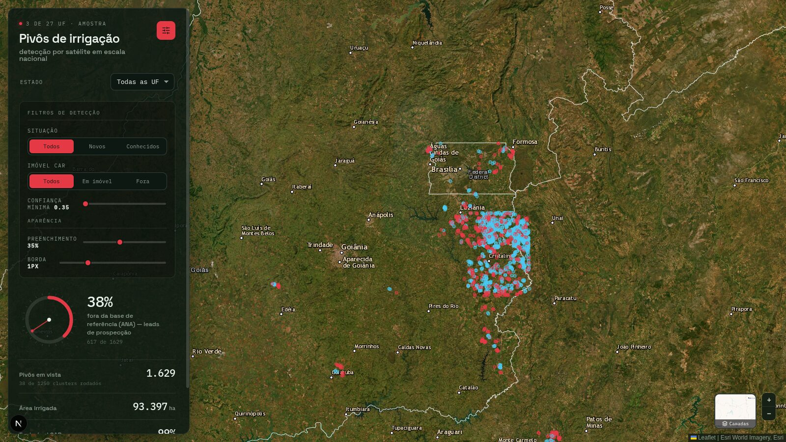
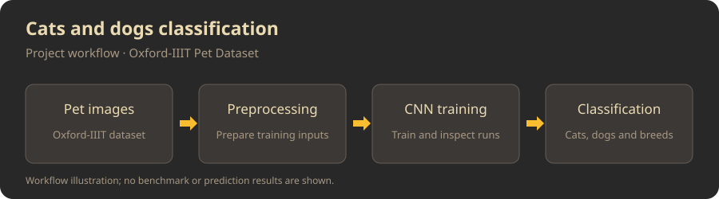
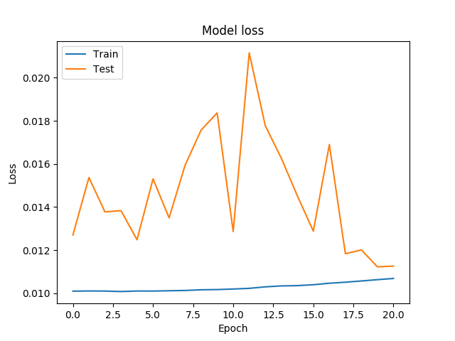

<h1 align="center">Hi 👋, I'm Juliano Donini</h1>
<h3 align="center">Computer Vision Engineer · Edge AI · MLOps</h3>

I build computer vision systems from data preparation and model training to cloud and edge inference. At Automizei, I develop product recognition and self-service retail solutions with YOLO and PyTorch, supported by MLOps pipelines. My background includes computer vision for agriculture and an MSc in Computer Science.

- 🔭 I’m currently working on [Automizei](https://www.automizei.com/)

## 🌐 Contact

&nbsp;&nbsp;

## 🔎 Featured Projects

### Irrigation Pivot Detection

Detects irrigation pivots in Sentinel-2 imagery with YOLO11 and compares them with Brazil's ANA reference data. The interactive demo shows a sample across three states, including detections outside the reference dataset.

**Stack:** Python · YOLO11 · GeoPandas · rasterio · Next.js · Leaflet

[Explore the live demo](https://datlo-ijqp.vercel.app/) · Source code is private.

### Cats and Dogs Classification

Explores CNN-based classification on the Oxford-IIIT Pet Dataset, progressing from cats versus dogs to breed classification. The repository includes dataset preparation, model training scripts, and TensorBoard instructions.

**Focus:** Image classification · CNNs · Dataset preparation

[View the repository](https://github.com/jdonini/cats-and-dogs-classification)

### Stacking Audio Tagging

My master's research implementation explores stacking with CNNs and autoencoders for audio tag classification. The graph above is one experiment's loss curve; the repository includes model definitions and additional evaluation plots.

**Focus:** Deep learning · Ensemble learning · Audio classification

[View the repository](https://github.com/jdonini/stacking-audio-tagging)

## 💻 Tech Stack

#### Machine Learning / Data Science

#### MLOps / Edge AI

CVAT · DVC · Comet ML · BentoML · ONNX · TensorRT · NVIDIA Jetson

#### Programming Languages

#### DevOps

#### Version Control

#### Databases

#### Cloud

#### Backend

#### Tools

<!--
- mflow
- plotly (https://www.vectorlogo.zone/logos/plotly/plotly-icon.svg)
- poetry (https://github.com/devicons/devicon/blob/master/icons/poetry/poetry-plain.svg)
- dvc (https://github.com/vscode-icons/vscode-icons/blob/master/icons/file_type_dvc.svg)
- kedro ()
- Metaflow
- Kibana (https://www.vectorlogo.zone/logos/elasticco_kibana/elasticco_kibana-icon.svg)
-->

## GitHub Stats ⚡

  

    
    
  

  

